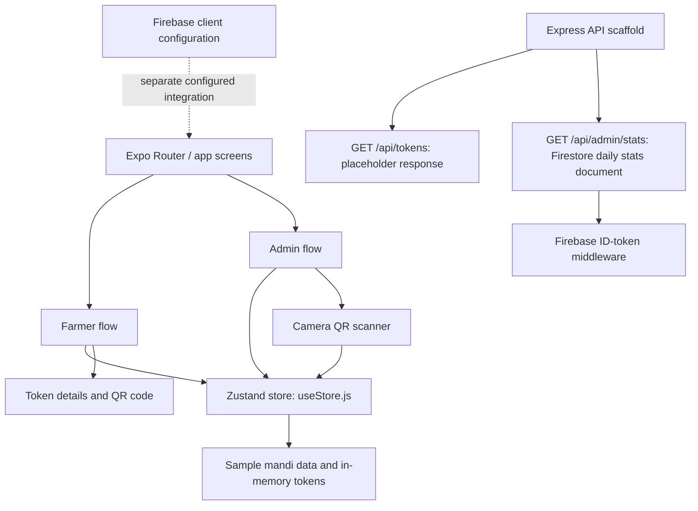

# KisanSewa — Smart Procurement Queue Management

**Smart India Hackathon (SIH) | Problem Statement reference: 26032 | Mobile application prototype**

KisanSewa is a mobile-first prototype for organising farmer visits to agricultural procurement centres (mandis). It models a slot-booking and token workflow for farmers and provides procurement-centre administrators with a queue overview and QR-token scanning interface.

The goal is to make procurement visits easier to plan, reduce uncertainty around arrivals, and give centre staff a clearer view of expected farmers and token status. This repository represents a working prototype direction—not a production deployment or a live government procurement system.

> **Prototype and data disclaimer:** The current booking, queue, and token flow is primarily powered by an in-memory Zustand store with preloaded sample mandi records. The displayed capacity and queue values are demonstration data, not verified live figures. Firebase configuration and an Express backend scaffold are present, but the main booking/scanning flow is not yet persisted through the backend. See [Current scope and limitations](#current-scope-and-limitations).

## Contents

- [The problem KisanSewa addresses](#the-problem-kisansewa-addresses)
- [Proposed solution](#proposed-solution)
- [Who the app is for](#who-the-app-is-for)
- [Current prototype capabilities](#current-prototype-capabilities)
- [Typical demo workflow](#typical-demo-workflow)
- [Technology stack](#technology-stack)
- [Architecture and data flow](#architecture-and-data-flow)
- [Project structure](#project-structure)
- [Run the mobile app locally](#run-the-mobile-app-locally)
- [Firebase configuration](#firebase-configuration)
- [Optional backend setup](#optional-backend-setup)
- [Security notes](#security-notes)
- [Current scope and limitations](#current-scope-and-limitations)
- [Roadmap](#roadmap)
- [SIH reviewer demo guide](#sih-reviewer-demo-guide)
- [Project documentation](#project-documentation)

## The problem KisanSewa addresses

Farmers taking produce to a procurement centre need to plan transport, timing, crop details, and quantity. When arrivals and queue information are difficult to coordinate, farmers may face uncertainty and centre staff may have limited visibility into expected arrivals.

KisanSewa explores a digital workflow for:

1. Showing farmers a list of procurement centres and indicative capacity/queue information.
2. Capturing the crop, quantity, preferred date, and time for a planned visit.
3. Creating a digital token with a QR code for the visit.
4. Giving centre staff a dashboard and a QR-scanning workflow to record a farmer's arrival.

The prototype is designed around the farmer and procurement-centre administrator journeys. It is not an official government portal and does not currently ingest verified live mandi data.

## Proposed solution

KisanSewa brings a farmer-facing booking flow and an administrator-facing queue view into one mobile application.

### For farmers

- Browse the preloaded mandi list.
- See each sample centre's location, indicative current queue, capacity, and accepted crops.
- Choose a centre, crop, quantity in quintals, date, and time.
- Receive a generated token and QR code for the planned procurement visit.
- View token details and a visual status timeline.

### For procurement-centre staff / administrators

- View summary cards for expected visits, current queue, farmers marked as reached, and weighed tokens (based on the prototype's current state).
- Review the mandi overview and recent tokens.
- Open the camera-based QR scanner and process a token when a farmer arrives.

### Design principle

The intended design is mobile-first and uses familiar labels, clear status indicators, and a green agricultural visual theme. A future deployment should add language selection and translations for the regions in which it will be used; multilingual support should not be considered implemented until it is added and tested in the app.

## Who the app is for

| Audience | Potential value |
|---|---|
| Farmers | Plan a procurement-centre visit, record crop/quantity information, and keep a token for reference. |
| Procurement-centre / mandi staff | Review expected arrivals and use the token-scanning flow to mark arrival. |
| Centre managers and procurement supervisors | Gain an overview of queues and operational activity once backed by a shared, persistent data source. |
| Farmer-producer organisations, cooperatives, and pilot partners | Evaluate whether a slot-and-token workflow could fit local procurement operations. |
| SIH evaluators and technical reviewers | Review the proposed user journeys, prototype architecture, technology choices, implementation gaps, and future deployment plan. |

## Current prototype capabilities

The following describes what is visible in the current code, with implementation scope called out where necessary.

| Capability | Current implementation status |
|---|---|
| Farmer/Admin entry screen | Implemented. The landing screen lets the user choose a role and navigates to the corresponding dashboard. This is a demo role selector, not an enforced security boundary. |
| Mandi directory and capacity indicators | Implemented with hard-coded sample mandi records in `store/useStore.js`. Values are not live or authoritative. |
| Procurement-slot form | Implemented: mandi, crop, quantity, date, and time inputs with validation for selected mandi, crop, and positive quantity. |
| Token generation | Implemented locally. A token and QR payload are generated in the Zustand store. |
| QR token display | Implemented in the farmer token screen using `react-native-qrcode-svg`. |
| Admin dashboard | Implemented as a UI over the local store, showing summary cards, queue/capacity indicators, and recent tokens. “Live” in screen labels does not mean a shared live server connection at this stage. |
| Camera-based QR scanner | Implemented using Expo Camera permission/scanning APIs. The current store changes a token from `Booked` to `Reached` after a recognised token is scanned. |
| Status lifecycle display | The UI models `Booked → Reached → Weighed → Paid`. In the current local flow, the scanner transitions a token to `Reached`; end-to-end weighing/payment workflows still need to be connected. |
| Firebase Authentication screen | A login screen and Firebase client setup exist. The home role-selection flow currently navigates directly to the dashboards, so authentication and role-based route protection are not yet enforced across the main demo flow. |
| Firebase Storage image uploader | A reusable image-upload component exists and uses Firebase Storage. Configure Firebase correctly before testing it. |
| Express / Firebase Admin backend | A backend scaffold exists. The token-list controller currently returns placeholder empty data; the main booking and scanning flow still uses the local Zustand store. |
| Multilingual UI, SMS notifications, live government data | Roadmap items—not currently implemented in the inspected code. |

## Typical demo workflow

### Farmer journey

1. Launch KisanSewa and choose **Farmer**.
2. Browse the mandi cards and review the sample queue/capacity indicators and accepted crops.
3. Select **Book Procurement Slot**.
4. Choose a mandi, crop, quantity, date, and time; submit the form.
5. Review the generated token, QR code, booking details, and visual status timeline.

### Administrator journey

1. Return to the landing screen and choose **Admin**.
2. Review the dashboard summary, mandi capacity overview, and recent tokens created in the current app session.
3. Open **Scan Farmer QR** and grant camera permission when prompted.
4. Scan a QR code generated by the same running demo session. The local store can mark a booked token as reached.

**Important for demos:** Because tokens are held in memory, use the same running app session to create and scan a token. A restart, reload, or separate device will not automatically share the token. A persisted backend is needed for real multi-user operation.

## Technology stack

| Layer | Technology | Role in the project |
|---|---|---|
| Mobile UI | React Native | Builds native mobile screens. |
| App framework | Expo SDK 54 | Development server, native module integration, and app tooling. |
| Navigation | Expo Router | File-based navigation for the landing, farmer, and admin screens. |
| Local state | Zustand | Holds sample mandis, current tokens, token status, and demo dashboard stats in memory. |
| QR generation | `react-native-qrcode-svg` | Renders token QR codes. |
| QR scanning | `expo-camera` | Camera permission and QR scanning interface. |
| Date/time input | `@react-native-community/datetimepicker` | Date and time selection in the booking form. |
| Styling | React Native `StyleSheet`, NativeWind, Tailwind CSS v3 | Screen styles and NativeWind configuration. |
| Firebase client | Firebase JS SDK | Auth, Firestore, and Storage configuration for Firebase-related features. |
| Backend | Node.js, Express, CORS, dotenv, Firebase Admin SDK | Partial API scaffold and Firebase Admin access. |
| Developer tooling | ESLint, Babel, Metro | Linting, transpilation, and React Native bundling. |

Package versions are defined in [`package.json`](./package.json). This project uses Expo / React Native; it is **not** a Vite React web project.

## Architecture and data flow



### Current data flow

- The booking screen calls `bookSlot()` in `store/useStore.js`.
- That function creates a token and QR payload, adds the token to Zustand state, and increments the selected sample mandi's queue count.
- The ticket screen reads the token from the same store and renders its QR code.
- The scanner parses the QR payload and calls `scanToken()` in the store. A matching token in `Booked` state is updated to `Reached`.
- The admin dashboard calculates its summary values from that same local store.
- Separately, the Express backend exposes a health endpoint, a placeholder token-list endpoint, and a Firebase-protected stats endpoint. The main UI flow is not yet wired to use the backend as its source of truth.

## Project structure

```text
Procurement_center/
├── app/
│   ├── _layout.js                 # Expo Router stack and shared screen options
│   ├── index.js                   # Landing screen and role selection
│   ├── auth/
│   │   └── login.js               # Firebase email/password login screen
│   ├── farmer/
│   │   ├── dashboard.js           # Mandi list and capacity/queue cards
│   │   ├── book.js                # Procurement-slot booking form
│   │   └── ticket.js              # QR token and status timeline
│   ├── admin/
│   │   ├── dashboard.js           # Queue summary and recent token UI
│   │   └── scanner.js              # Camera QR scanner
│   ├── config/
│   │   └── firebase.js            # Firebase client initialization
│   └── global.css                 # NativeWind / Tailwind directives
├── assets/images/                 # App icon, splash, favicon, and related assets
├── backend/
│   ├── index.js                   # Express server and API mounts
│   ├── middleware/
│   │   └── authMiddleware.js      # Firebase ID-token verification
│   ├── routes/
│   │   └── tokenRoutes.js         # Token API route definitions
│   └── controllers/
│       └── tokenController.js     # Current placeholder token response
├── components/
│   └── ImageUploader.js           # Image picker and Firebase Storage upload
├── contexts/
│   └── AuthContext.js             # Lightweight React context for user/login/logout state
├── constants/                     # Shared constants (inspect individual files before changing)
├── hooks/                         # Custom hooks (inspect individual files before changing)
├── scripts/
│   └── reset-project.js           # Starter-template reset script; destructive to project folders
├── store/
│   └── useStore.js                # Sample data and local token/queue operations
├── .claude/                       # Claude-specific project instructions/settings
├── .vscode/                       # VS Code workspace settings
├── .gitignore                     # Ignores dependencies, generated files, and secret keys
├── AGENTS.md                      # AI coding instruction pointing to Expo SDK 54 docs
├── CLAUDE.md                      # Claude instruction entry point
├── COMPATIBILITY.md               # Expo / native dependency compatibility notes
├── SETUP.md                       # Existing setup notes
├── SIH26032.md                    # Project feature/status summary for SIH 26032
├── app.json                       # Expo app identity, icons, plugins, and platform config
├── babel.config.js                # Babel and Reanimated plugin config
├── eslint.config.js               # ESLint configuration
├── metro.config.js                # Metro + NativeWind configuration
├── nativewind-env.d.ts            # NativeWind type declaration
├── package.json                   # App scripts and dependencies
├── package-lock.json              # npm dependency lockfile
├── postcss.config.js              # PostCSS configuration
├── tailwind.config.js             # Tailwind / NativeWind content paths and preset
└── tsconfig.json                  # TypeScript tooling configuration
```

See [`PROJECT_GUIDE.md`](./PROJECT_GUIDE.md) for a file-by-file explanation and important implementation notes.

## Run the mobile app locally

### Prerequisites

- Node.js LTS and npm
- Git
- Expo Go on a compatible physical device, or an Android emulator / supported development environment

### 1. Clone the repository

```bash
git clone https://github.com/Akash-singh909/Procurement_center.git
cd Procurement_center
```

### 2. Install dependencies

```bash
npm install
```

### 3. Start Expo

```bash
npx expo start
```

Scan the QR code with Expo Go when using a compatible device, or use the terminal shortcuts for an available emulator. For a physical device, the computer and phone normally need to be reachable on the same network. The app requests camera access for the QR-scanner flow.

Useful alternatives:

```bash
npx expo start --clear  # clear Metro cache and start
npx expo start --web    # try the web target (native camera features may differ)
npm run lint            # run the configured Expo lint command
```

The app scripts can also be found in `package.json` (`start`, `android`, `ios`, `web`, and `lint`).

## Firebase configuration

The Firebase client configuration in `app/config/firebase.js` reads these Expo public environment variables:

```dotenv
EXPO_PUBLIC_FIREBASE_API_KEY=
EXPO_PUBLIC_FIREBASE_AUTH_DOMAIN=
EXPO_PUBLIC_FIREBASE_PROJECT_ID=
EXPO_PUBLIC_FIREBASE_STORAGE_BUCKET=
EXPO_PUBLIC_FIREBASE_MESSAGING_SENDER_ID=
EXPO_PUBLIC_FIREBASE_APP_ID=
EXPO_PUBLIC_FIREBASE_MEASUREMENT_ID=
```

Create a local `.env` in the repository root and populate these values from your own Firebase project. Restart Expo after changing environment variables. Configure Authentication, Firestore, and Storage in the Firebase console before testing the relevant features.

The public client configuration is not a substitute for Firebase Security Rules. Restrict database and storage access appropriately. Never put a Firebase Admin service-account JSON file or private credentials in the client app or commit them to Git.

## Optional backend setup

The repository contains backend source files, but the current root listing does not include a separate `backend/package.json`. If you want to run the backend locally, initialise its Node package once and install its server dependencies:

```bash
cd backend
npm init -y       # one-time setup if backend/package.json does not exist
npm install express cors firebase-admin dotenv
```

Create `backend/.env` locally:

```dotenv
PORT=4000
FIREBASE_SERVICE_ACCOUNT_PATH=../serviceAccountKey.json
```

Place your own Firebase Admin service-account JSON at the configured path (or set `FIREBASE_SERVICE_ACCOUNT_PATH` to the correct local path). Keep that file private; `.gitignore` contains service-account ignore rules. Then start the backend from the `backend` directory:

```bash
node index.js
```

The health endpoint is `http://localhost:4000/` when using port 4000. The current `GET /api/tokens` controller is a placeholder that returns an empty list. `GET /api/admin/stats` reads the `stats/daily` Firestore document and requires a valid Firebase ID token. These endpoints are not yet the data source for the app's main booking flow.

## Security notes

This is a hackathon prototype and should not be deployed as a production procurement service without further work.

- The landing screen is a role selector, not secure authorisation; dashboards are reachable through navigation.
- The Firebase login screen exists, but the main landing flow does not currently enforce login before entering dashboards.
- The backend's CORS policy currently allows all origins. Restrict allowed origins before deployment.
- Verify the caller's role/permissions on server routes; verifying a Firebase ID token alone does not prove the caller is an administrator.
- Add appropriate Firebase Auth, Firestore, and Storage security rules.
- Add validation and transactional booking logic on the server to avoid conflicting bookings or capacity overruns.
- Use only sample/demo data in presentations until trusted live data sources are integrated.

## Current scope and limitations

The code is a useful proof of concept for the user flow, but the following gaps matter when evaluating readiness:

1. **In-memory state:** Zustand tokens and queue changes are not persisted. Data is reset when the app process/store is recreated and is not shared with another device.
2. **Backend integration:** The booking, ticket, scan, and dashboard screens operate against Zustand. The token API controller currently returns placeholder data.
3. **Authentication and roles:** A Firebase login screen exists but is not enforced by the landing-to-dashboard path; proper role-based access control is still needed.
4. **Status workflow:** The UI displays `Booked`, `Reached`, `Weighed`, and `Paid`, but the scanner currently performs only the `Booked` → `Reached` transition. The weighing and payment workflow needs real operational actions and persistence.
5. **Manual scanner route:** The scanner links to `/admin/manual-scan`, but a matching `app/admin/manual-scan.js` route was not found in the current repository paths inspected. Add that screen or remove the link before a live demo.
6. **Environment setup:** Firebase environment values and the backend service-account credential must be provided locally by the developer.
7. **Multilingual support and notifications:** Hindi, Marathi, other regional-language UI, SMS/push notifications, and official data integrations remain roadmap items.
8. **Testing:** Add unit/component tests, API integration tests, and end-to-end tests for booking, capacity limits, authentication, duplicate scans, and status transitions.

## Roadmap

### Priority 1 — Make the core workflow reliable

- Persist mandis, bookings, tokens, and token status in Firestore or a server-side database.
- Connect the mobile app to the backend instead of using the local store as the source of truth.
- Enforce authenticated farmer/admin identities and server-side role checks.
- Validate slot capacity atomically on the server and prevent duplicate/over-capacity bookings.
- Complete the manual token-entry screen and the `Weighed` / `Paid` operations.

### Priority 2 — Make it field-ready

- Add Hindi, Marathi, and other regional-language translations with language selection.
- Add opt-in SMS/push notifications for booking confirmation, reminders, and status changes.
- Integrate verified procurement-centre data and clearly show when queue/capacity figures were last updated.
- Design for intermittent connectivity, accessibility, low-end Android devices, and clear error recovery.

### Priority 3 — Quality and deployment

- Add automated tests, error logging, audit history, and monitoring.
- Review data privacy, consent, retention, and access policies.
- Configure and test production builds through Expo/EAS and document release procedures.
- Run a supervised pilot with farmers and procurement-centre staff before any operational rollout.

## SIH reviewer demo guide

For a concise prototype walkthrough:

1. **Problem and audience (30 seconds):** Explain the need to plan procurement-centre visits and give staff visibility into expected arrivals.
2. **Farmer workflow (60–90 seconds):** Show the mandi list, capacity/queue indicator, booking form, and generated QR token.
3. **Administrator workflow (60–90 seconds):** Show the admin dashboard and scan the QR token created in the same app session. Point out that the current scan updates the local status to `Reached`.
4. **Architecture (30–60 seconds):** Explain React Native + Expo, Expo Router, Zustand prototype state, Firebase configuration, and the Express backend scaffold.
5. **Honest next steps (30 seconds):** State that persistent backend integration, authentication/role enforcement, live mandi data, regional languages, notifications, and complete weighing/payment steps are still to be finished.

This framing demonstrates both the user value and an understanding of what is required to move from a prototype to a reliable public-service application.

## Project documentation

- [SIH 26032 feature/status notes](./SIH26032.md)
- [Setup notes](./SETUP.md)
- [Compatibility notes](./COMPATIBILITY.md)
- [File-by-file project guide](./PROJECT_GUIDE.md)
- [Source repository](https://github.com/Akash-singh909/Procurement_center)

---

**KisanSewa is a prototype built to explore a more planned, transparent procurement-centre visit—not a claim that live procurement infrastructure has already been deployed.**
